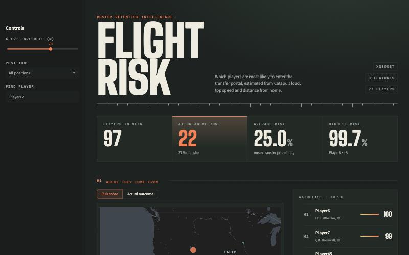

# 🏈 Predictive Roster Management: Transfer Portal Risk Dashboard

[](https://jinwoo1015.github.io/-Churn-Analysis-of-College-Football-Retention/)

**Live Demo:** [**Open the Flight Risk dashboard →**](https://jinwoo1015.github.io/-Churn-Analysis-of-College-Football-Retention/)

[](https://jinwoo1015.github.io/-Churn-Analysis-of-College-Football-Retention/)

## 📌 Project Overview
In modern college football, roster retention is just as critical as recruiting. This project translates raw GPS/Catapult physical data and geographic metrics into an actionable "flight risk" dashboard, helping coaching staffs proactively identify players who are statistically highly likely to enter the transfer portal. 

Rather than stopping at a Jupyter Notebook, this project features a fully deployed interactive web application built with Streamlit. It provides an end-to-end machine learning solution, complete with individual risk breakdowns and an interactive spatial map to visualize transfer trends across player hometowns, bridging the gap between complex model outputs and actionable stakeholder insights.

## 🚀 Key Features
* **XGBoost Predictive Engine:** A machine learning model trained to identify non-linear relationships between physical exertion, geographical distance from home, and the likelihood of transferring.
* **Geographic Risk Mapping:** Includes a dynamic, interactive Plotly map visualizing player hometowns to help coaches identify spatial or regional trends in transfer behavior.
* **Interactive Roster Dashboard:** A clean, automated UI that sorts the current roster from highest risk to lowest risk, and also the sorting options to subset the roster for easier visualization.
* **Actionable "Why" Metrics:** The dashboard isolates the specific driver of a player's risk score (e.g., highlighting if their `Avg_Player_Load_Per_Min` is dangerously high), allowing strength and conditioning staff to intervene immediately.
* **Handled Class Imbalance:** Utilized SMOTE (Synthetic Minority Over-sampling Technique) to ensure the model accurately detects the minority class (players who transfer) without bias.

## 🛠️ Tech Stack
* **Language:** Python
* **Machine Learning:** `xgboost`, `scikit-learn`, `imbalanced-learn`
* **Data Manipulation:** `pandas`, `numpy`
* **Frontend/Deployment:** `streamlit`

## 🧠 Model Architecture & Data
The core model is an XGBoost Classifier integrated into a Scikit-Learn Pipeline. 
* **Scaling:** `StandardScaler` applied to normalize varying units of measurement.
* **Imbalance Handling:** `SMOTE` applied to the training data to synthesize examples of the minority class (transfers), improving the model's recall.
* **Key Features:**
  * `Avg_Player_Load_Per_Min`: A measure of physical intensity during practice/games.
  * `Season_Max_Velocity`: The player's top speed recorded.
  * `homeLatitude`: Used as a geographical proxy for the player's distance from their hometown.

## 💻 How to Run Locally

If you would like to run this application on your local machine, follow these steps:

1. **Clone the repository:**
   ```bash
   git clone https://github.com/jinwoo1015/-Churn-Analysis-of-College-Football-Retention.git
   cd -Churn-Analysis-of-College-Football-Retention
   ```
2. **Install the dependencies:**
   ```bash
   pip install -r requirements.txt
   ```
3. **Run the Streamlit version** and open http://localhost:8501 (the live site is the static page in `docs/`):
   ```bash
   streamlit run app.py
   ```

## 📁 Project Structure
```text
├── docs/                     # Static dashboard served by GitHub Pages (index.html, style.css, data.js)
├── scripts/build_site.py     # Scores the roster and writes docs/data.js
├── app.py                    # Streamlit version of the dashboard (local use)
├── dashboard/
│   ├── data.py               # Loads the model and roster, scores risk
│   ├── charts.py             # Plotly figures (map, distribution, by position)
│   └── ui.py                 # HTML fragments and CSS injection
├── assets/style.css          # Theme: type, colour, layout
├── .streamlit/config.toml    # Dark base theme
├── model/                    # Version-independent export of the model (xgb.json, scaler.json)
├── scripts/export_model.py   # Regenerates model/ from the original pickle
├── transfer_model.pkl        # The original serialized XGBoost pipeline (training environment only)
├── chunn_model_data_repo.csv # The cleaned dataset used for dashboard population
├── catapult.csv              # Original dataset for the analysis and modeling
├── roster_data.csv           # Original dataset for the analysis and modeling
├── portal_data.csv           # Original dataset for the analysis and modeling
├── churn_model_UA_Football.qmd # EDA, SMOTE and model training (Quarto)
└── README.md                 # Project documentation
```

## 📬 Contact
### Jinwoo Choi
* LinkedIn: [[LinkedIn link](https://www.linkedin.com/in/jinwoochoi1015/)]
* GitHub: [[GitHub link](https://github.com/jinwoo1015)]
